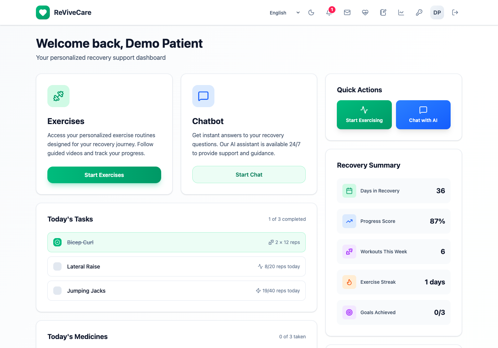
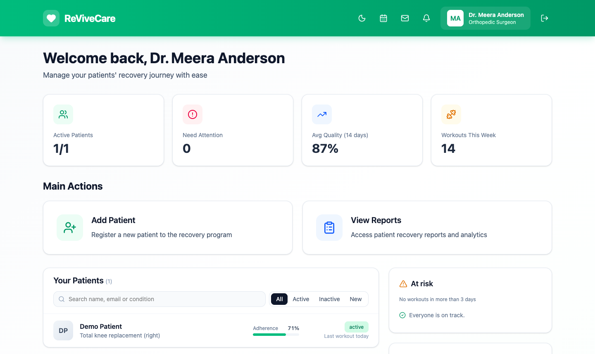
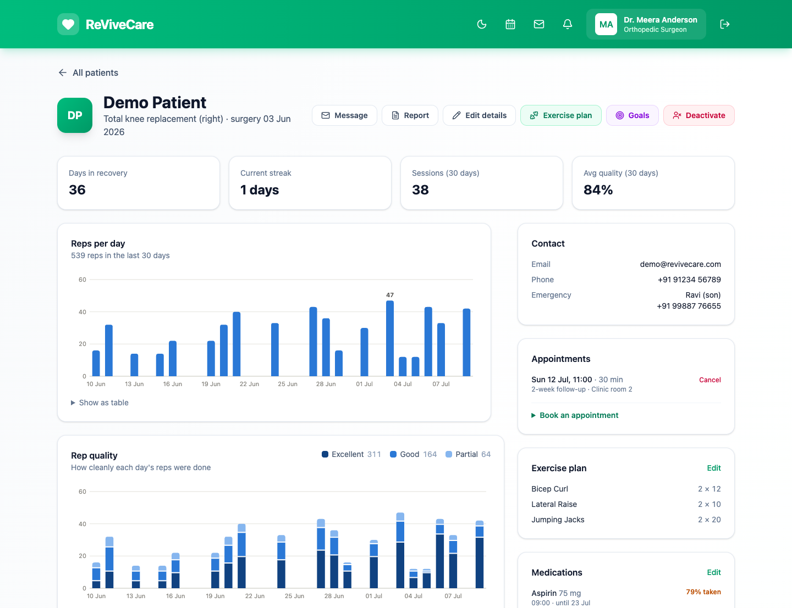
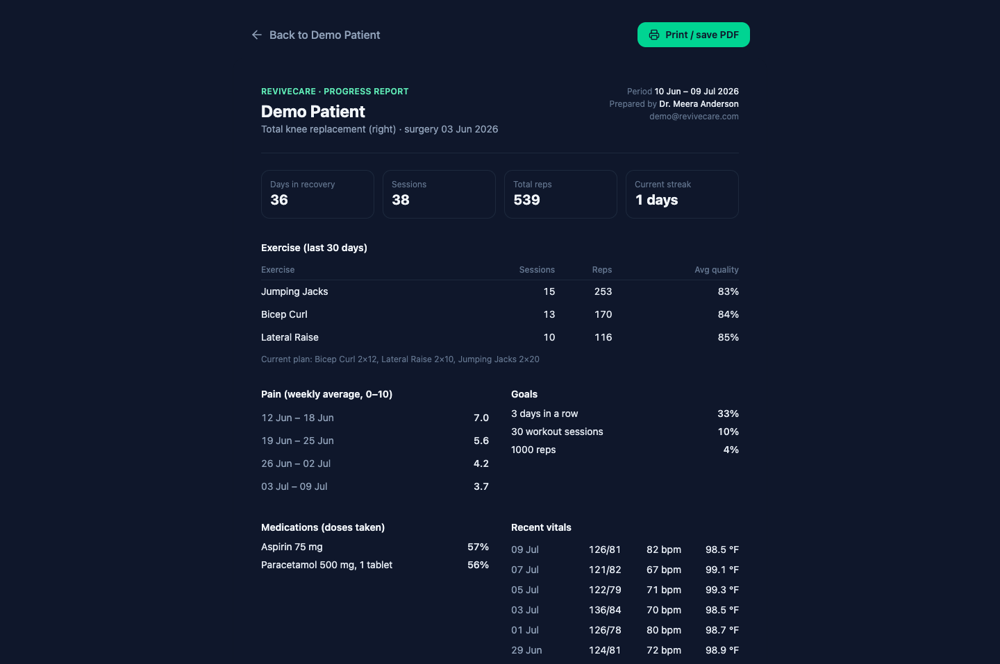
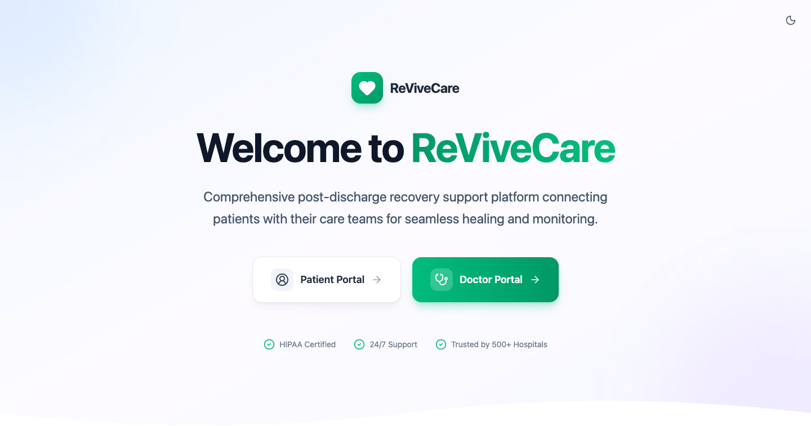
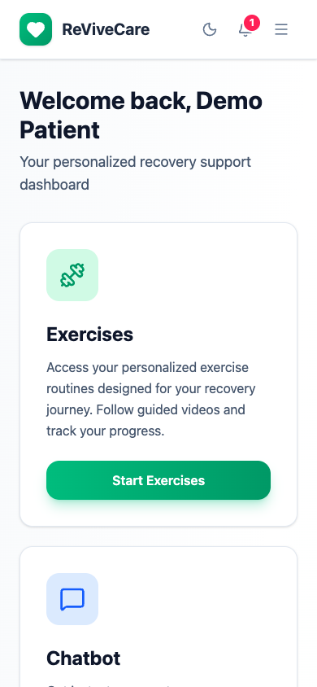

# ReviveCare

ReviveCare is a comprehensive healthcare platform designed to bridge the gap between patients and doctors through advanced technology. It combines AI-driven rehabilitation tracking, a smart conversational assistant, and efficient patient management into a unified experience.

This application leverages computer vision to provide real-time feedback on physical therapy exercises, ensuring patients perform their routines correctly and safe at home. Simultaneously, it offers doctors a streamlined dashboard to monitor patient progress and manage care plans effectively.

## Features

### For patients
*   **Camera-guided exercises**: pose tracking runs in the browser (MediaPipe Pose), counts reps, grades each one (excellent, good or partial) and coaches out loud. The camera feed never leaves the device.
*   **Today's plan**: the exercises, sets and reps the doctor assigned, today's medicine doses to tick off, goals with progress bars and achievement badges.
*   **Recovery assistant**: an AI chat (Groq) that knows the patient's plan, recent progress, pain diary and medicines. Replies stream in, and it answers in English, Hindi, Marathi or Tamil, by voice or text. Worrying messages alert the doctor by email, and by SMS when Twilio is set up.
*   **Pain diary and vitals**: daily pain scores and symptoms, pain checks before and after workouts, and home readings of blood pressure, heart rate and temperature. Rising pain or out-of-range vitals raise an alert.
*   **Messages and appointments**: a thread with the care team, the next appointment with an *Add to calendar* file, a video-call link and a reschedule request.
*   **Notifications and reminders**: in-app notifications plus emails for medicines, appointments and a weekly progress summary, each of which can be switched off.
*   **Works everywhere**: Hindi interface, light and dark themes, phone layouts, keyboard and screen-reader support. It installs as an app (PWA) with an offline page and cached exercise videos.

### For doctors
*   **Dashboard**: every patient with adherence and status, the patients at risk of dropping off, recent vitals (out-of-range first), unread alerts and messages.
*   **Patient record**: charts of reps, rep quality, pain and vitals, plus the exercise plan, goals, medications with adherence and missed doses, appointments, clinical notes and the assistant chat history.
*   **Care tools**: assign exercises with per-patient targets, set goals, prescribe medicines, book appointments (clash-checked, with a calendar week view) and message patients.
*   **Reports**: a printable 30-day progress report, a CSV export of every workout and a weekly digest email.
*   **Accountability**: every view of and change to a patient record is written to a read-only audit log.

## Screenshots

| Patient dashboard | Doctor dashboard |
|---|---|
|  |  |
| **Patient record** | **Progress report (dark mode)** |
|  |  |
| **Landing page** | **On a phone** |
|  |  |

## Technology Stack

*   **Django 5.1** serves both the pages (`Backend/templates/`) and a small JSON API. Postgres (Neon) is used in production and SQLite locally, both via `DATABASE_URL`.
*   **Tailwind CSS v4** is compiled to `Backend/static/css/app.css` with the standalone CLI (see the comment in `static/css/input.css`). **Lucide** icons are served locally.
*   **MediaPipe Pose** runs in the browser for exercise tracking, with the rep logic in `static/js/reps.js`. Charts are hand-written SVG (`static/js/charts.js`).
*   **Groq** (through `langchain-groq`) powers the recovery assistant, Gmail SMTP sends email, and Twilio sends optional SMS alerts.
*   **Vercel** hosts the app, with **Sentry** for optional error monitoring.

## Getting Started

Follow these instructions to set up the project locally on your machine.

### Prerequisites
*   Python 3.11 or higher
*   Git

### Installation

1.  **Clone the repository**
    ```bash
    git clone <repository-url>
    cd ReviveCare
    ```

2.  **Setup**
    ```bash
    cd Backend
    python3.11 -m venv venv
    source venv/bin/activate  # On Windows use `venv\Scripts\activate`
    pip install -r requirements.txt
    cp .env.example .env      # then fill in DATABASE_URL, GROQ_API_KEY, etc.
    ```

3.  **Run**
    ```bash
    python manage.py migrate
    python manage.py runserver
    ```
    Open `http://127.0.0.1:8000`. The pages and the API are both served by Django.

### Deploy (Vercel)

Vercel detects Django from `Backend/manage.py`, runs `collectstatic`, and serves static files from its CDN.

```bash
cd Backend
vercel        # pick "Django" as the framework; root directory is Backend
vercel --prod
```

Set the environment variables below in the Vercel project. In production you need at least `SECRET_KEY` and `DATABASE_URL`. Leave `DEBUG` and `COOKIE_SECURE` unset there.

Deploys don't migrate the database. After pushing a change with new migrations, run them against Neon from `Backend/`:

    DATABASE_URL='<Neon connection string>' python manage.py migrate

#### Preview deployments on a Neon branch

Give previews their own database so test data and unmerged migrations never reach production:

1. In the Neon console, create a branch from `main` (for example `preview`) and copy its connection string.
2. In Vercel → Settings → Environment Variables, add `PREVIEW_DATABASE_URL` with that string, scoped to **Preview** only.
3. Migrate the branch (`DATABASE_URL='<branch connection string>' python manage.py migrate`) and redeploy a preview. It reads and writes only the branch.

Without `PREVIEW_DATABASE_URL`, previews use `DATABASE_URL`, the production database. To refresh the branch with current production data, reset it from its parent in the Neon console.

### Environment variables

All are read in `Backend/ReviveCare/settings.py` or where noted. `Backend/.env.example` lists them with local defaults; copy it to `Backend/.env`.

| Variable | Needed | What it does |
|---|---|---|
| `SECRET_KEY` | Production | Django's signing key. Without it the app refuses to start unless `DEBUG=True`. |
| `DEBUG` | Local only | `True` for development: detailed errors and a built-in fallback secret key. |
| `DATABASE_URL` | Production | Database connection string: Neon Postgres in production, `sqlite:///db.sqlite3` locally. |
| `PREVIEW_DATABASE_URL` | Optional | Neon branch used by Vercel Preview deployments instead of `DATABASE_URL`. |
| `COOKIE_SECURE` | Local only | `False` lets session cookies work over plain `http://localhost`. |
| `SITE_URL` | Recommended | Public address used in links inside emails sent by the scheduled commands. |
| `LOG_LEVEL` | Optional | Root log level (default `INFO`). Requests are logged as one JSON line each. |
| `GROQ_API_KEY` | For chat | Key for the recovery assistant (Groq). Without it the chat replies with a fallback message. |
| `GROQ_MODEL` | Optional | Groq model name (default `openai/gpt-oss-120b`). |
| `EMAIL_PASSWORD` | For email | SMTP password (a Gmail app password). Without it emails are printed to the console. |
| `EMAIL_SENDER`, `SMTP_SERVER`, `SMTP_PORT` | Optional | Sending address and SMTP server (default Gmail on port 587). |
| `DOCTOR_EMAIL` | Optional | Where chat alerts go when a patient has no doctor with an email address. |
| `TWILIO_ACCOUNT_SID`, `TWILIO_AUTH_TOKEN`, `TWILIO_PHONE_NUMBER` | For SMS | Text doctors about serious alerts. All three are needed. |
| `TO_NUMBER` | Optional | SMS fallback when the doctor's profile has no phone number. |
| `SENTRY_DSN` | Optional | Report errors to Sentry. No request bodies, cookies or personal data are sent. |
| `SENTRY_TRACES_SAMPLE_RATE` | Optional | Share of requests traced for performance, 0 to 1 (default 0). |
| `HSTS_SECONDS` | Optional | Turn on HSTS once the custom domain serves HTTPS everywhere. Start at 3600. |
| `HSTS_INCLUDE_SUBDOMAINS`, `HSTS_PRELOAD` | Optional | HSTS flags (defaults `True` and `False`). |

Vercel sets `VERCEL_ENV` and `VERCEL_GIT_COMMIT_SHA` itself; they choose the preview database and tag Sentry releases.

## Usage

### Demo data

```bash
cd Backend
python manage.py seed_demo
```

This creates a doctor (`doctor` / `Doctor-demo-2026`) and a patient (`demo@revivecare.com` / `demo1234`) with 30 days of workouts, pain entries, vitals, medicines, messages and an upcoming appointment. It's safe to re-run, and it refuses to run with `DEBUG` off unless you pass `--allow-production`.

*   **Doctors** sign in at `/doctor/login/` to manage patients. Superusers also get `/admin/`, including the audit log and demo requests.
*   **Patients** sign in at `/patient/login/`. The first sign-in asks for a new password. Exercises need a webcam and enough light to see the whole body.

### Scheduled jobs

Run these with `python manage.py <command>` from a scheduler such as cron or a scheduled GitHub Actions workflow with the production environment variables:

| Command | Suggested schedule | What it does |
|---|---|---|
| `send_medication_reminders` | hourly | Emails doses due in the next hour that aren't ticked off yet. |
| `send_appointment_reminders` | hourly | Emails patients about appointments roughly 24 hours away. |
| `send_weekly_progress` | Mondays 09:00 | A summary of each patient's last 7 days. |
| `send_doctor_digest` | Mondays 08:00 | Each doctor's open alerts, unread messages, at-risk patients and week ahead. |
| `cleanup` | daily | Deletes expired sessions, old read notifications and audit entries past retention (2 years by default). |

### Tests

```bash
cd Backend
python manage.py test --settings=ReviveCare.test_settings   # Django tests
node --test static/js/reps.test.js                          # rep counting on recorded poses
node tests/smoke.mjs                                        # clicks through the app in headless Chrome (needs seed_demo and a running server)
```

CI runs all three on every push (`.github/workflows/ci.yml`) and also checks that the compiled CSS is up to date.

## Contributing

Contributions are welcome. If you have suggestions for improvements or new features, please feel free to submit a pull request or open an issue for discussion.

## License

This project is licensed under the MIT License.
